This chapter was migrated from the legacy Equation Generation documentation.
The [Quarto source](equation_generation.qmd), figure assets, and editable drawing
sources are kept together in this directory.

## Circuit Topology and Graph Theory

The topology of an electrical network may be encapsulated by one or more directed graphs. In the context of such a representation, graph nodes are analogous to network nodes and graph edges are analogous to network branches, where a branch represents the network element connected between any two network nodes.

A network branch has two associated attributes: branch current and branch voltage. Therefore, two distinct directed graphs are obtained from a single electrical network: the directed branch current graph and the directed branch voltage graph. An example of such a transformation is shown below.

<table>
<tr>
  <td align="center">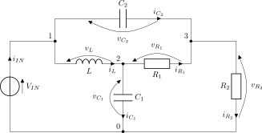 (a)</td>
  <td align="center">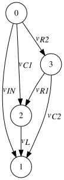 (b)</td>
  <td align="center">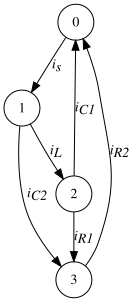 (c)</td>
</tr>
</table>

**Figure 1.** A simple electrical network (a) and its corresponding directed branch voltage graph (b) and directed branch current graph (c).

Note that the sign convention of the original electrical network has been maintained in both the directed current and voltage graphs. In this example, the arrows of the directed current graph indicate the direction of positive current flow within a branch. Likewise, the arrows of the directed voltage graph point towards the positive terminal, or node, of the branch.

## Graph Theory Definitions

A *loop* within a graph is a set of branches that form a closed path.

<table>
<tr>
  <td align="center">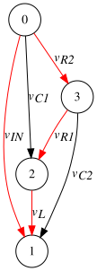 (a)</td>
  <td align="center">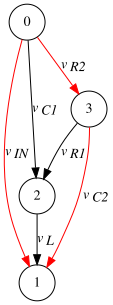 (b)</td>
  <td align="center"> (c)</td>
</tr>
</table>

**Figure 2.** Three examples of closed loops within a simple graph.

A *cut* is a set of branches in a graph which, when cut off, will divide the graph into two disconnected pieces. Each of these pieces is called a *surface*.

<table>
<tr>
  <td align="center">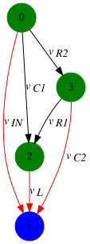 (a)</td>
  <td align="center">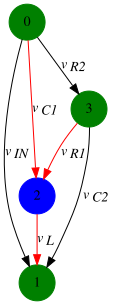 (b)</td>
  <td align="center">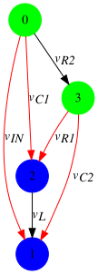 (c)</td>
</tr>
</table>

**Figure 3.** Three examples of cuts within a simple graph.

A *tree* is a set of branches in a graph in which any two nodes are connected by exactly one path. A tree therefore contains no loops. If additional branches are added to the graph a loop will form. There may be many possible trees identifiable within a graph. The set of branches that do not form part of the tree are termed the *co-tree*.

<table>
<tr>
  <td align="center">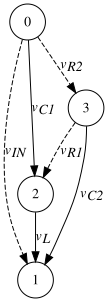 (a)</td>
  <td align="center">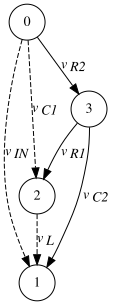 (b)</td>
  <td align="center">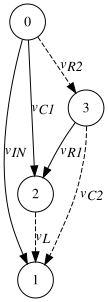 (c)</td>
</tr>
</table>

**Figure 4.** Three examples of graph trees (solid lines) and corresponding co-trees (dashed lines).

A *basic cut* is a cut which contains only one tree branch. If a graph contains *t* tree branches, there are *t* basic cuts.

<table>
<tr>
  <td align="center">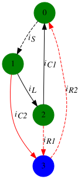 (a)</td>
  <td align="center">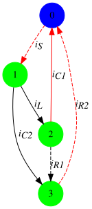 (b)</td>
  <td align="center">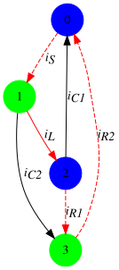 (c)</td>
</tr>
</table>

**Figure 5.** Three examples of basic cuts.

A *basic loop* is a loop which contains only one co-tree branch. There is one basic loop for each co-tree branch.

<table>
<tr>
  <td align="center">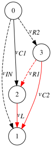 (a)</td>
  <td align="center">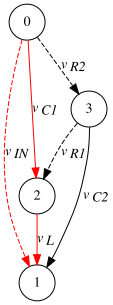 (b)</td>
  <td align="center">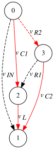 (c)</td>
</tr>
</table>

**Figure 6.** Three examples of basic loops.

## Kirchhoff\'s Current Law (KCL)

Kirchhoff\'s Current Law (KCL) establishes the relationship between the currents converging on a circuit node. The law states that *the algebraic sum of the currents in all the branches that converge in a common node is equal to zero*. Adopting the convention that current flow directed towards a node is positive, the KCL equations of the nodes for the electrical network displayed above are presented in the table below.

  Node   KCL Equation
  ------ -----------------------
  0      $i_{C_1} + i_{R_2} - i_S = 0$
  1      $i_S - i_{C_2} - i_L = 0$
  2      $i_L - i_{C_1} - i_{R_1} = 0$
  3      $i_{R_1} + i_{C_2} - i_{R_2} = 0$

KCL may be generalised by considering graph surfaces that contain one or more nodes. Written in this form, KCL states that *the algebraic sum of the currents entering and leaving a surface is equal to zero*. Adopting the convention that positive currents flow into the surface containing the nodes coloured blue, the KCL equations for the three surfaces of the electrical network displayed above are presented in the table below.

  Surface   KCL Equation
  --------- -----------------------
  0         $i_{C_2} + i_{R_1} - i_{R_2} = 0$
  1         $i_{C_1} + i_{R_2} - i_S = 0$
  2         $i_L + i_{R_2} - i_S - i_{R_1} = 0$

To understand why this generalisation of KCL is valid, consider the KCL equations of nodes 0 and 2 which form a surface in example 3:

$$
\begin{gathered}
i_L - i_{C_1} - i_{R_1} = 0 \\
        i_{C_1} + i_{R_2} - i_S = 0
\end{gathered}
$$

Equation (5).

Notice that branch current $i_{C_1}$ appears in both equations and that it does not form part of the basic cut of example 3. Adding the equations of [(5)](#equation-5):

$$
i_L + i_{R_2} - i_S - i_{R_1} = 0
$$

Equation (6).

Which is identical to the equation derived using the surface definition of KCL. This form of KCL presents a convenient method of deriving network equations that contain only a single tree branch ($i_L$) which will prove useful when formulating a complete network description.

## Independent KVL and KCL Equations

It can be shown that a network with $l$ branches and $k$ nodes exhibits $m = l - (k - 1)$ linearly independent loop equations and $p = k - 1$ linearly independent node equations. Therefore, a complete description of the network, free from redundancy, requires exactly $m$ loop equations and $p$ node equations. Analysis of equations [(1)](#equation-1) - [(4)](#equation-4) shows that the equations are **linearly dependent**. If one equation is arbitrarily omitted, the remaining set of equations are **linearly independent**, as expected.

## Independent State Variables

State space representation of dynamical systems requires their state variables to be linearly independent i.e. no state variable can be written as a linear combination of the other state variables or the system will not be able to be solved. This will also prevent the arbitrary assignment of initial conditions. Certain network topologies give rise to dependency amongst the potential state variables of the system. This occurs in two distinct forms:

1.  Loops consisting exclusively of capacitive elements and/or voltage sources
2.  Nodes connected to branches containing only inductors and/or current sources

**Figure 7.** A simple electrical network displaying a capacitive loop.

As an example of condition 1, consider the network shown above which displays a loop consisting of three capacitors and a voltage source. The KVL equation of this loop may be written as:

$$
v_{in} - v_{C_1} - v_{C_2} - v_{C_3} = 0
$$

Equation (7).

From equation [(7)](#equation-7) it is clear that any of the system variables, $v_{C_1}$, $v_{C_2}$ or $v_{C_3}$, can be expressed as a linear combination of the other variables and system input. Alternatively, at time $t = t_0$, the initial conditions of the state variables cannot be assigned arbitrary values if equation [(7)](#equation-7) is to hold. Selecting all three of the variables $v_{C_1}$, $v_{C_2}$ and $v_{C_3}$ for inclusion in the state vector will therefore result in a system which cannot be solved.

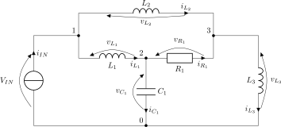

**Figure 8.** A simple electrical network displaying a node connected only to inductive branches and current sources.

As an example of condition 2, consider the network shown above in which node 1 is connected to two inductive branches and a current source. The KCL equation for node 1 may be written as:

$$
i_{s} - i_{L_1} - i_{L_2} = 0
$$

Equation (8).

From equation [(8)](#equation-8) it is clear that any of the system variables, $i_{L_1}$ and $i_{L_2}$ can be expressed as a linear combination of the other variables and system input. Alternatively, at time $t = t_0$, the initial conditions of the state variables cannot be assigned arbitrary values if equation [(8)](#equation-8) is to hold. Selecting both of the variables $i_{L_1}$ and $i_{L_2}$ for inclusion in the state vector will therefore result in a system which cannot be solved.

## Selection of State Variables

A systematic approach to identifying the minimum set of linearly independent state variables required to completely define the system is obtained by forming the *proper tree* of the network. The proper tree is a graph tree derived from the original network graph. Member branches of the proper tree are a subset of the original graph which are selected according to the following order of priorities:

1.  All branches corresponding to a voltage source must be selected.
2.  The maximum possible number of branches corresponding to a capacitor should be selected. Recall that the definition of a tree prohibits graph loops and as such, it may not be possible to include every capacitor of the network in the proper tree.
3.  The maximum possible number of branches corresponding to a resistor should be selected such that the definition of tree is not violated.
4.  The necessary number of branches corresponding to inductors and current sources required to complete the graph tree should be selected.

With the formulation of a proper tree, state variables of the network are selected as the branch voltages of all capacitors whose branches are members of the proper tree and the branch currents of all inductors whose branches are members of the proper co-tree.

<table>
<tr>
  <td align="center"> (a)</td>
  <td align="center">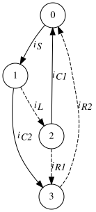 (b)</td>
</tr>
</table>

**Figure 9.** A simple electrical network and the corresponding proper tree. Solid lines indicate proper tree branches. Dashed lines indicate proper co-tree branches.

As an example of identifying the proper tree, consider the network and corresponding proper tree shown above. Notice that both capacitor branches of the network are members of the proper tree (solid lines) and that the inductor branch is a member of the proper co-tree (dashed lines). The state vector of this network may therefore be written as:

$$
\mathbf{x} =
        \begin{bmatrix}
        v_{C_1} \\
        v_{C_2} \\
        i_{L} \\
        \end{bmatrix}
$$

If resistor $R_1$ of the figure above is replaced with a capacitor, the network and corresponding proper tree is as shown in the figure below.

<table>
<tr>
  <td align="center"> (a)</td>
  <td align="center"> (b)</td>
</tr>
</table>

**Figure 10.** A simple electrical network and the corresponding proper tree demonstrating a capacitive/voltage source loop.

Notice that the above network exhibits a loop consisting of three capacitors and a voltage source. Only the $C_1$ and $C_2$ capacitor branches are members of the proper tree. If $C_3$ were to be included then a loop would be formed, violating the definition of the proper tree. This is an example of where not all capacitor branches can be included in the proper tree. Note that an equally valid proper tree may be formed using any two of the capacitor branches and the choice of which two to use is arbitrary. Since one of the capacitor branches is linearly dependent on the other two, its value may be calculated from the system variables and inputs. For the example shown above, $v_{C_3}$ may be calculated as:

$$
v_{C_3} = v_{C_1} + v_{C_2} - v_{in}
$$

The state vector for the network shown above may be written as:

$$
\mathbf{x} =
        \begin{bmatrix}
        v_{C_1} \\
        v_{C_2} \\
        i_{L} \\
        \end{bmatrix}
$$

Recall that branches corresponding to inductors may be required to complete the proper tree. Such a situation arises when a node exists that is connected only to inductors and current sources. An example of such a network and its corresponding proper tree are shown below. Note that an equally valid proper tree may be formed using any one of the inductive branches ($L_1$, $L_2$ or $L_3$).

<table>
<tr>
  <td align="center"> (a)</td>
  <td align="center">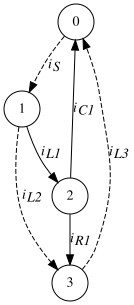 (b)</td>
</tr>
</table>

**Figure 11.** A simple electrical network and the corresponding proper tree demonstrating a node connected only to inductors and current sources.

The state vector for the network shown above may be written as:

$$
\mathbf{x} =
        \begin{bmatrix}
        v_{C_1} \\
        i_{L_2} \\
        i_{L_3} \\
        \end{bmatrix}
$$

The inductor, $L_1$, which was required to complete the proper tree does not contribute to the state vector. This inductor is linearly dependent on other system variables and is therefore not required to solve the system. This is demonstrated by writing the KCL equation at node 1:

$$
i_{L_1} = i_{S} - i_{L_2}
$$

## Fundamental Cut-set Matrix (Qf)

The fundamental cut-set matrix $\mathbf{Q_f}$ expresses the algebraic relationship of the branch currents flowing between the surfaces pertaining to the basic cuts of a network. It can be derived once the proper tree of the network has been identified. For example, the proper tree shown in [Figure 5](#figure-5) has three proper tree branches and therefore:

The proper tree branch $i_{C2}$ is in the basic loops formed by co-tree branches $i_{R1}$ and $i_{R2}$.

The proper tree branch $i_{C1}$ is in the basic loops formed by co-tree branches $i_{S}$ and $i_{R2}$.

The proper tree branch $i_{L}$ is in the basic loops formed by co-tree branches $i_{R1}$, $i_{R2}$ and $i_{R2}$.

Notice that in each of the basic loops described above, the list of traversed branches describes a basic cut. Therefore, it is clear that co-tree branches which form a basic loop with a proper tree branch are equivalent to the basic cut corresponding to this proper tree branch. For the proper tree branch $i_{C2}$, if the branch currents flowing into the surface containing nodes 0, 1 and 2 are considered as positive current flows, then the KCL equation for this basic cut may be written as:

$$
i_{C2} + i_{R1} - i_{R2} = 0
$$

Equation (9).

Likewise, for the proper tree branch $i_{C1}$, if the branch currents flowing into the surface containing nodes 1, 2 and 3 are considered as positive current flows, the KCL equation for this basic cut may be written as:

$$
i_{C1} + i_{R2} - i_{S} = 0
$$

Equation (10).

Finally, for the proper tree branch $i_{L}$, if the branch currents flowing into the surface containing nodes 1 and 3 are considered as positive current flows, the KCL equation for this basic cut may be written as:

$$
i_{L} + i_{R2} - i_{S} -i_{R1} = 0
$$

Equation (11).

Equations [(9)](#equation-9), [(10)](#equation-10) and [(11)](#equation-11) may be compactly expressed in matrix form:

$$
\begin{bmatrix}
        1 & 0 & 0 & 1 & -1 & 0 \\
        0 & 1 & 0 & 0 & 1 & -1 \\
        0 & 0 & 1 & -1 & 1 & -1 \\
        \end{bmatrix} \begin{bmatrix}
        i_{C2} \\
        i_{C1} \\
        i_{L} \\
        i_{R1} \\
        i_{R2} \\
        i_{S} \\
        \end{bmatrix} = \mathbf{0}
$$

Equation (12).

$$
\mathbf{Q_f} \mathbf{I_T} = \mathbf{0}
$$

Equation (13).

## Fundamental Basic Loop Matrix (Bf)

The fundamental basic loop matrix $\mathbf{B_f}$ expresses the algebraic relationship of the branch voltages around the basic loops of a network. It can be derived once the co-tree of the network has been identified. For example, the proper tree shown in [Figure 6](#figure-6) has three co-tree branches and therefore the KVL equations may be written as:

$$
v_{R1} + v_{L} - v_{C2} = 0
$$

Equation (14). 

$$
v_{IN} - v_{L} - v_{C1} = 0
$$

Equation (15). 

$$
v_{R2} + v_{C2} - v_{L} - v_{C1} = 0
$$

Equation (16).

Equations [(14)](#equation-14), [(15)](#equation-15) and [(16)](#equation-16) may be compactly expressed in matrix form:

$$
\begin{bmatrix}
        -1 & 0 & 1 & 1 & 0 & 0 \\
        0 & -1 & -1 & 0 & 0 & 1 \\
        1 & -1 & -1 & 0 & 1 & 0 \\
        \end{bmatrix} \begin{bmatrix}
        v_{C2} \\
        v_{C1} \\
        v_{L} \\
        v_{R1} \\
        v_{R2} \\
        v_{IN} \\
        \end{bmatrix} = \mathbf{0}
$$

Equation (17). 

$$
\mathbf{B_f} \mathbf{V_T} = \mathbf{0}
$$

Equation (18).

## Formulation of Network Equations

Formulating a set of circuit equations is a multistep process. The procedure for any network is as follows:

1.  Identify any valid proper tree. State variables can be determined.
2.  Identify the basic loops and basic cuts for the selected proper tree.
3.  For each basic cut, derive the KCL equation corresponding to the surfaces created by this basic cut.
4.  For each basic loop, derive the corresponding KVL equation.
5.  Substitute the constitutive relationships into the derived equations and perform any necessary algebraic manipulations.

As an example of the above process, consider the network and corresponding proper tree shown in the figure below.

<table>
<tr>
  <td align="center"> (a)</td>
  <td align="center">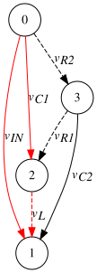 (b)</td>
</tr>
</table>

**Figure 12.** A simple electrical network and corresponding proper tree (solid lines). Branches shown in red form a basic loop with inductor $L$, resistor $R_1$ and resistor $R_2$ respectively.

Since capacitors $C_1$ and $C_2$ are members of the proper tree and inductor $L$ is a member of the co-tree, the state vector of the system may be written as:

$$
\mathbf{x} =
        \begin{bmatrix}
        v_{C_1} \\
        v_{C_2} \\
        i_{L} \\
        \end{bmatrix}
$$

The $\mathbf{B_f}$ matrix can be derived with the aid of the proper tree and applying KVL loop analysis. The KVL loop for inductor $L$ is shown above.

$$
\mathbf{B_f} =
        \begin{bmatrix}
        -1 & 0 & 1 & 1 & 0 & 0 \\
        1 & -1 & 0 & -1 & 1 & 0 \\
        -1 & 1 & 0 & 0 & 0 & 1 \\
        \end{bmatrix} \begin{bmatrix}
        v_{in} \\
        v_{C2} \\
        v_{L} \\
        v_{C1} \\
        v_{R1} \\
        v_{R2} \\
        \end{bmatrix} = \mathbf{0}
$$

Equation (19).

The first row of the $\mathbf{B_f}$ matrix relates to the inductor, $L$. The second two rows describe KVL equations for resistors $R_1$ and $R_2$:

$$
\begin{bmatrix}
        L \\
        \end{bmatrix} \begin{bmatrix}
        \frac{di_{L}}{dt} \\
        \end{bmatrix} = \begin{bmatrix}
        v_{in} - v_{C1} \\
        \end{bmatrix}
$$

Equation (20).

The $\mathbf{Q_f}$ matrix can be derived with the aid of the proper tree and applying the KCL surface analysis described above. The KCL surfaces for capacitors $C_1$ and $C_2$ are shown below.

<table>
<tr>
  <td align="center">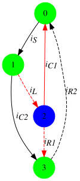 (a)</td>
  <td align="center">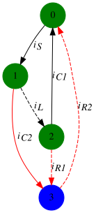 (b)</td>
</tr>
</table>

**Figure 13.** Basic cuts for capacitors $C_1$ and $C_2$ used to analyse the network shown above.

If the convention that current flows in a positive direction through capacitors $C_1$ and $C_2$ is adopted, the $\mathbf{Q_f}$ matrix may be written as:

$$
\mathbf{Q_f} =
        \begin{bmatrix}
        1 & 0 & 1 & 0 & -1 & 1 \\
        0 & 1 & 0 & 0 & 1 & -1 \\
        0 & 0 & -1 & 1 & 1 & 0 \\
        \end{bmatrix} \begin{bmatrix}
        i_{S} \\
        i_{C2} \\
        i_{L} \\
        i_{C1} \\
        i_{R1} \\
        i_{R2} \\
        \end{bmatrix} = \mathbf{0}
$$

Equation (21).

The first row of the $\mathbf{Q_f}$ matrix relates to the voltage source, $V_S$. The second two rows describe KCL equations for capacitors $C_1$ and $C_2$:

$$
\begin{bmatrix}
        C_{2} & 0 \\
        0 & C_{1} \\
        \end{bmatrix} \begin{bmatrix}
        \frac{dv_{C_2}}{dt} \\
        \frac{dv_{C_1}}{dt} \\
        \end{bmatrix} = \begin{bmatrix}
        i_{R2} - i_{R1} \\
        i_{L} -  i_{R1} \\
        \end{bmatrix}
$$

Equation (22).

Equations [(20)](#equation-20) and [(22)](#equation-22) together form a complete description of the electrical network. The quantities $i_{R1}$ and $i_{R2}$ are required before the equations can be solved. They may be determined by solving the $\mathbf{B_f}$ matrix equations relating to those edges:

$$
v_{in} - v_{C2} - v_{C1} + v_{R1} = 0
$$

Equation (23). 

$$
-v_{in} + v_{C2} + v_{R2} = 0
$$

Equation (24).

Which, when divided by their component resistances, give the current through those edges.

In general, the current through resistors that form part of the co-tree can be determined by solving the $\mathbf{B_f}$ equations relating to those edges. Likewise, the voltage across a resistor that forms part of the spanning-tree can be determined by solving the $\mathbf{Q_f}$ equations relating to those edges.
